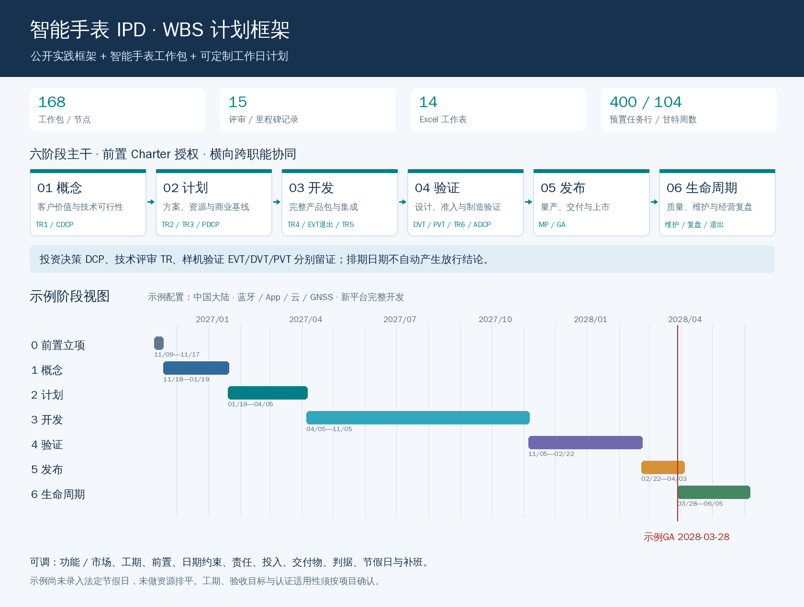

# 智能手表 IPD WBS

面向整机项目经理的智能手表 IPD 流程与可定制计划模板，包含 **168 个工作包/节点、15 个评审或里程碑记录、14 张 Excel 工作表**。

以“概念 → 计划 → 开发 → 验证 → 发布 → 生命周期”为主线，覆盖市场与商业、系统、硬件、结构、射频、固件、算法、App、云、安全隐私、认证、供应链、制造及售后。

## 下载与阅读

- [Excel 可定制模板](deliverables/智能手表_IPD_WBS_可定制模板.xlsx?raw=true)
- [IPD 流程与使用指南](deliverables/智能手表_IPD流程与使用指南.md)
- [流程与计划概览 PDF](deliverables/智能手表_IPD流程与计划概览.pdf)
- [WBS 数据 CSV](deliverables/智能手表_IPD_WBS_数据.csv)
- [完整交付包 ZIP](deliverables/智能手表_IPD_WBS_交付包.zip?raw=true)
- [验证报告](deliverables/验证报告.md)



## 快速开始

1. 下载 Excel，先阅读 `00使用说明`。
2. 在 `01项目配置` 填写启动日、状态日期、目标 GA、功能及市场范围、休息日和补班。
3. 在 `03WBS` 确认工期、前置依赖、日期约束、负责人、投入、交付物与验收标准。
4. 在 `04评审门禁`、`10认证矩阵` 和 `11需求追踪` 维护签批及证据。
5. 查看 `05周甘特` 和 `06项目看板`，经批准后保存基线，按周更新。

默认配置为中国大陆蓝牙运动健康手表，包含 App、云与 GNSS。工期、日期、投入及质量目标均为示例，须由各领域负责人确认。建议使用 Excel 2019/365 或支持所用函数的新版 WPS，并开启自动计算。

## 可定制范围

- 功能与市场：GNSS、NFC、LTE/eSIM、Wi-Fi、ECG、医疗用途、中国大陆、欧盟、美国及退市。
- 任务计划：逐任务启用/停用、工期、最多四个 FS 前置、非负工作日间隔和最早开始约束。
- 日历：每周工作模式、额外休息日及周末补班。
- 管理：R/A/C、完成率、计划/基线/实际日期、证据、风险、变更、认证与需求追踪。

WBS 预置 400 行公式，甘特展示 104 周。前置任务须位于后继行之前；扩容、插行或结构排序后应复核相关公式和链接。模板按逻辑依赖排期，资源需要人工排平。

## 流程依据

- [IBM Research：Concepts in the definition of an enterprise development process](https://research.ibm.com/publications/concepts-in-the-definition-of-an-enterprise-development-process)
- [华为产品安全基线白皮书](https://www-file.huawei.com/admin/asset/v1/pro/view/44e2e06553364e42b97aca0c9ff333b6.pdf)，PDF 第 5 页、文内页码 05。
- [PMI：IBM 开发组织项目管理实践](https://www.pmi.org/learning/library/2019/04/07/15/15/institutionalizing-project-management-development-community-4802)

原始链接及引用边界见 Excel 的 `12来源依据`。具体工作包、工期、准入准出条件及 TR 与 EVT/DVT/PVT 的对应关系，是智能手表裁剪建议，正式流程和授权由公司确认。排期日期及任务完成率不自动产生放行结论。

## 目录

```text
deliverables/           Excel、CSV、指南、概览、交付包和验证报告
scripts/build_ipd.py     生成 Excel、CSV、任务库与计划摘要
scripts/wbs_data.py      工作包、评审及来源定义
scripts/make_preview.py  生成流程与计划概览 PNG/PDF
scripts/validate_ipd.py  独立排期对照及 LibreOffice 重算检查
data/task_library.json  结构化工作包数据
data/build_summary.json 生成时的计划摘要
requirements.txt        Python 依赖
```

## 重新生成

建议 Python 3.10 或更高版本。在仓库根目录执行：

```bash
python3 -m venv .venv
source .venv/bin/activate
python -m pip install -r requirements.txt
python scripts/build_ipd.py
```

修改任务定义见 `scripts/wbs_data.py`；修改默认日期、范围开关或表格布局见 `scripts/build_ipd.py`。重新生成会覆盖对应生成文件，应先保存手工定制版本。

概览生成需要 Pillow 和中文字体。默认字体路径为 `/usr/share/fonts/truetype/wqy/wqy-zenhei.ttc`，其他系统请修改 `scripts/make_preview.py` 的 `FONT`。

```bash
python scripts/make_preview.py
```

验证需要安装 LibreOffice Calc，且 `libreoffice` 可在命令行调用：

```bash
python scripts/validate_ipd.py
```

验证包括默认、全功能多市场、精简及错误前置四组场景。本次已通过 LibreOffice Calc 26.2 重算，未在 Microsoft Excel/WPS 客户端实机验证。ZIP 为本次交付快照，重新生成单个文件后如需分发 ZIP，应重新打包。
